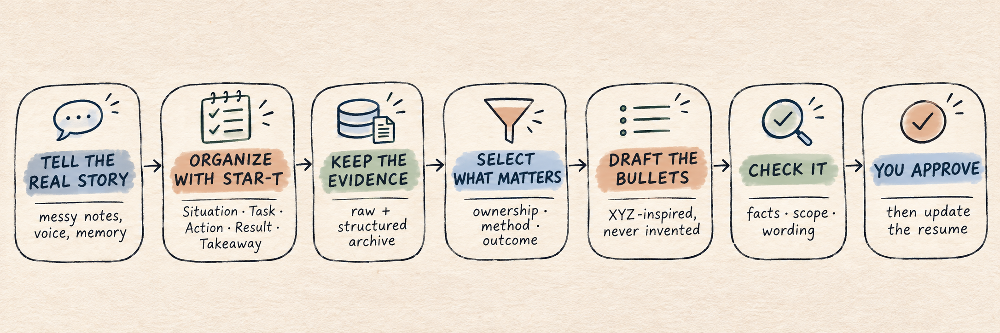

<div align="center">

# Experience-to-Resume

**Turn what actually happened into resume bullets—without making things up.**

</div>



## 1. TL;DR

This skill does two jobs, in order.

First, it helps me unpack one experience in normal language and save the real details: what happened, what I did, what worked, what failed and what I took away from it. I call this the **STAR-T principle**—the usual Situation, Task, Action and Result, plus one more **T for Takeaway**.

Then it selects the useful evidence and turns it into concise, XYZ-inspired resume bullets. It does not invent a metric just because a bullet looks empty without one.

**Raw story → structured evidence → proposed bullets → fact check → my approval**

## 2. Why I made this

When I try to write the resume too early, I start polishing before I have remembered the important part. The technical decisions, ugly failures and actual lessons get flattened into generic words.

This skill keeps those two problems separate:

- **Stage 1 preserves the experience.** I can talk through rough notes, voice transcripts or memory without trying to sound professional.
- **Stage 2 writes for the reader.** It chooses evidence, checks ownership and drafts only what the record can support.

The archive stays richer than the resume. That is the point.

## 3. How it works

The skill has four modes:

- `ORGANIZE` — take one raw experience and reconstruct it with STAR-T.
- `WRITE` — turn an existing experience record into proposed resume bullets.
- `REVIEW` — compare current bullets with the source record and point out weak or unsupported claims.
- `UPDATE` — apply an exact change only after I approve it.

The resume is never the source of truth. The raw narration and structured archive are.

## 4. Try it

Clone the repo into your Codex skills folder:

```bash
git clone https://github.com/LaneTang/experience-to-resume.git ~/.codex/skills/experience-to-resume
```

Then start with something like:

```text
Use Experience-to-Resume ORGANIZE mode. I want to talk through a project.
```

For the writing stage:

```text
Use WRITE mode on Experience 09. Draft the bullets, but do not change my resume.
```

For an approved update:

```text
I approve those exact bullets. Update the resume baseline.
```

## 5. What is inside

```text
experience-to-resume/
├── SKILL.md
├── references/
│   ├── methodology-part1.md
│   └── methodology-part2.md
├── templates/
│   ├── experience-record.md
│   └── resume-entry.md
└── assets/
    └── workflow.png
```

`SKILL.md` is the entrypoint. The two methodology files hold the detailed rules, and the templates keep the archive and resume proposal consistent.

## 6. A few rules I care about

- Keep the raw version and the reconstructed version separate.
- Separate what I personally built from what the team accomplished.
- Keep failures and uncertainty in the archive.
- Never turn planned work into completed work.
- Metrics are useful when they are real. They are not mandatory.
- A draft stays a draft until I approve it.

This skill provides the workflow, not storage or background memory. Keep the experience records and approved resume baselines somewhere persistent that the agent can access.
